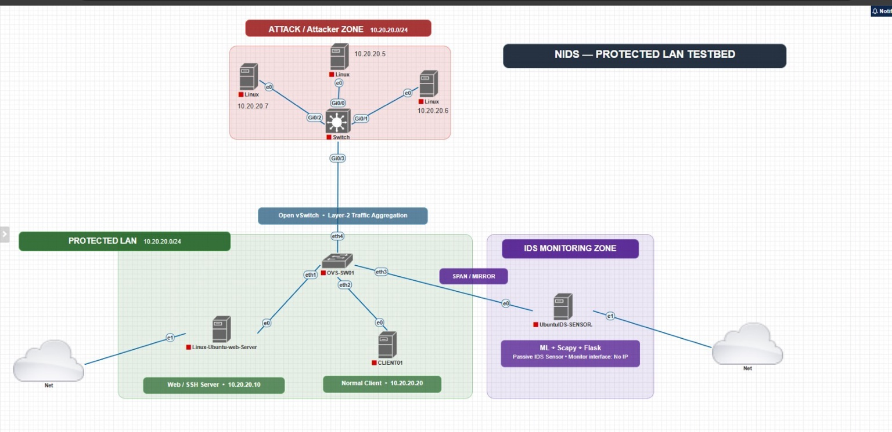
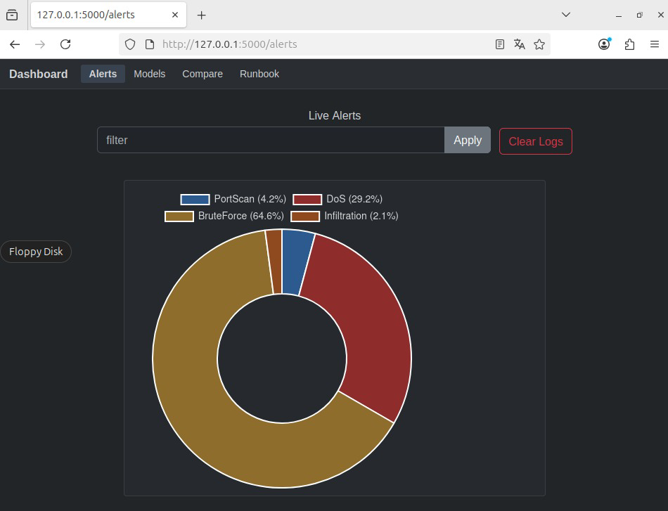

# NIDS PNETLab Live Testing Environment

This directory contains the PNETLab environment used to validate the NIDS project with live network traffic. It complements the main project README: the main repository documents the NIDS system and code, while this directory documents the emulated network, node configuration, traffic mirroring, and live validation procedure.

## Directory Layout

```text
pnetlab/
├── README.md
├── lab/
│   └── NIDS_Protected_LAN_CLEAN_ZONES.unl
├── docs/
│   ├── PNETLAB_SETUP.md
│   ├── OVS_SETUP.md
│   ├── NODE_SETUP.md
│   └── TESTING.md
└── screenshots/
    ├── topology.jpeg
    ├── ovs-mirror.png
    ├── dashboard-overview.png
    └── ... evidence images
```

## Lab Purpose




The lab provides a controlled Layer-2 testbed for generating benign and malicious traffic and feeding a mirrored copy of that traffic to the IDS sensor.

```text
Attackers
  10.20.20.5
  10.20.20.6
  10.20.20.7
      \
       Attack Switch
            |
            | uplink
            |
         OVS-SW01
       /     |      \
WEB-SRV01 CLIENT01  IDS Sensor
.10        .20      SPAN -> ens3
```

All test hosts use the same subnet:

```text
10.20.20.0/24
```

No default gateway is required on the test interfaces because the traffic remains inside the same Layer-2 subnet.

## Final Addressing Plan

| Node | Test IP | Purpose |
|---|---:|---|
| Attacker 1 | `10.20.20.5/24` | Attack source |
| Attacker 2 | `10.20.20.6/24` | Attack source |
| Attacker 3 | `10.20.20.7/24` | Attack source |
| WEB-SRV01 | `10.20.20.10/24` | Main target / Web and SSH server |
| CLIENT01 | `10.20.20.20/24` | Normal client / benign traffic |
| IDS `ens3` | No IP | Passive SPAN / mirror interface |
| IDS `ens4` | DHCP | Management access |

## PNETLab Images / Templates

The `.unl` file references the following images. These images are not included in this repository and must already exist on the PNETLab server.

| Lab Node | PNETLab Template / Image |
|---|---|
| OVS-SW01 | `pnetlab/openvswitch-ids:latest` |
| IDS Sensor | `linux-ubuntu-24.04-nids` |
| WEB-SRV01 | `linux-ubuntu-server-24.04` |
| CLIENT01 | `linux-ubuntu-mate-20.04` |
| Attacker 1 | `linux-kali-2025.4` |
| Attacker 2 | `linux-kali-2025.4` |
| Attacker 3 | `linux-kali-2025.4` |
| Attack Switch | `viosl2-15.2.4.55e` |

> The repository stores the topology and documentation only. Large QEMU disks, ISO files, and vendor images should not be committed to GitHub.

## PNETLab Platform Setup

For a complete build-from-scratch guide covering VMware installation, nested virtualization, PuTTY/SSH, WinSCP/SFTP, image upload, ISO-to-QCOW2 installation, VMDK-to-QCOW2 conversion, lab import, and node startup, see [`docs/PNETLAB_SETUP.md`](docs/PNETLAB_SETUP.md).

## Importing the Lab

Copy the lab file to the PNETLab labs directory:

```bash
cp NIDS_Protected_LAN_CLEAN_ZONES.unl /opt/unetlab/labs/
```

Fix permissions:

```bash
/opt/unetlab/wrappers/unl_wrapper -a fixpermissions
```

Then open PNETLab, load `NIDS_Protected_LAN_CLEAN_ZONES`, and verify that all referenced images are available.

## Open vSwitch Port Mapping

The final OVS mapping is:

```text
eth1 -> WEB-SRV01
eth2 -> CLIENT01
eth3 -> IDS Sensor
eth4 -> Attack Switch uplink
```

`eth3` is the mirror output toward the IDS sensor. The bridge is `br0`, and the configured mirror is named `ids-mirror`.

Full configuration and verification commands are documented in [`docs/OVS_SETUP.md`](docs/OVS_SETUP.md).

## Running the IDS

On the IDS sensor, run the dashboard and sniffer in separate terminals.

Dashboard:

```bash
cd ~/NIDS
source .venv/bin/activate
python app.py
```

Live sniffer:

```bash
cd ~/NIDS
sudo .venv/bin/python sniffer.py ens3
```

The IDS monitoring interface `ens3` is intentionally unnumbered. It receives mirrored traffic from OVS and should not be used as a normal routed interface.

## Current Live Validation Status

| Traffic Class | Current Result |
|---|---|
| Benign | PASS when normal traffic produces no alert |
| PortScan | PASS |
| BruteForce | PASS |
| DoS | PASS |
| DDoS | NOT DETECTED in current live test |
| WebAttack | NOT DETECTED in current live test |
| Bot | NOT DETECTED in current live test |
| Infiltration | PASS |

The failed detections are retained in the documentation instead of being presented as successful. Their observed behavior and suspected runtime causes are documented in [`docs/TESTING.md`](docs/TESTING.md).

## Screenshot Evidence

Selected clean evidence screenshots are stored in [`screenshots/`](screenshots/). The set includes the final topology, OVS mirror verification, IDS runtime, dashboard, successful alert evidence, and server network/service verification. Missing or unavailable evidence remains explicitly listed as a placeholder in [`screenshots/README.md`](screenshots/README.md).



## Additional Documentation

- [`docs/PNETLAB_SETUP.md`](docs/PNETLAB_SETUP.md) — PNETLab installation in VMware, remote file transfer, QEMU image creation/conversion, lab import, and node startup.
- [`docs/OVS_SETUP.md`](docs/OVS_SETUP.md) — bridge, port mapping, SPAN/mirror configuration and verification.
- [`docs/NODE_SETUP.md`](docs/NODE_SETUP.md) — IDS, server, client and attacker configuration.
- [`docs/TESTING.md`](docs/TESTING.md) — live test procedure, commands, expected behavior and current results.
- [`screenshots/README.md`](screenshots/README.md) — placeholder naming scheme for evidence screenshots to be added later.
