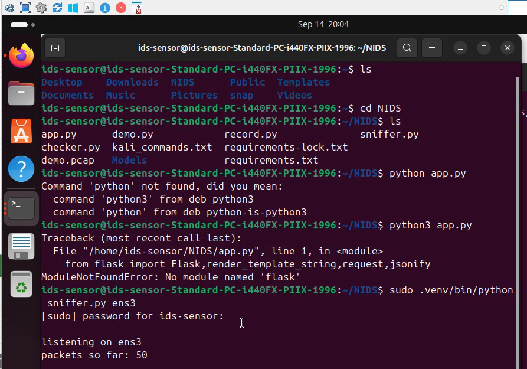
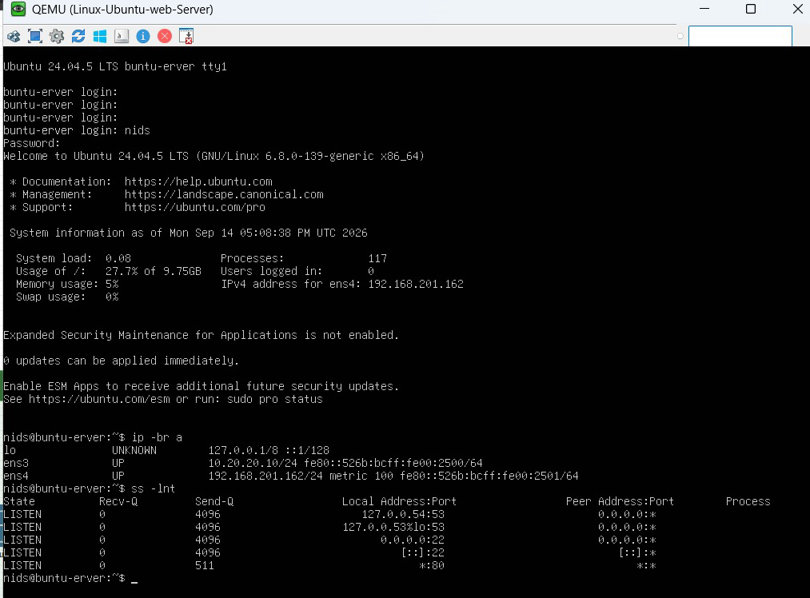

# PNETLab Node Setup

## 1. IDS Sensor

### Image

```text
linux-ubuntu-24.04-nids
```

### Interfaces

```text
ens3 -> monitoring / SPAN interface -> no IPv4 address
ens4 -> management network -> DHCP
```

`ens3` is placed in promiscuous mode and is used only for packet capture.

### Project Location

```text
~/NIDS
```

### Python Environment

The IDS uses a local virtual environment:

```bash
cd ~/NIDS
source .venv/bin/activate
```

### Start Dashboard

```bash
cd ~/NIDS
source .venv/bin/activate
python app.py
```

### Start Live Detection

```bash
cd ~/NIDS
sudo .venv/bin/python sniffer.py ens3
```

The sniffer should report that it is listening on `ens3` and its packet counter should increase when mirrored traffic crosses OVS.



---

## 2. WEB-SRV01

### Image

```text
linux-ubuntu-server-24.04
```

### Interfaces

```text
ens3 -> 10.20.20.10/24
ens4 -> Management / DHCP
```

The test interface does not require a default gateway because all test nodes are in `10.20.20.0/24`.

### Netplan

The test server configuration used:

```yaml
network:
  version: 2
  ethernets:
    ens3:
      addresses:
        - "10.20.20.10/24"
    ens4:
      dhcp4: true
```

Apply with:

```bash
sudo netplan apply
```

### Required Services / Tools

```bash
sudo apt update
sudo apt install -y apache2 openssh-server netcat-openbsd curl
sudo systemctl enable --now apache2 ssh
```

The final server interface and listening-service verification is shown below.



Permanent services used by the lab:

```text
TCP/22 -> SSH
TCP/80 -> Apache HTTP
```

Temporary test ports:

```text
TCP/8081 -> DoS/DDoS SYN-drop test target
TCP/9001 -> Bot test listener
TCP/9002 -> Infiltration test listener
```

### Temporary SYN DROP Rule

For the DoS/DDoS SYN-flood test, the server was configured to silently drop incoming SYN packets on TCP/8081:

```bash
sudo iptables -I INPUT 1 -p tcp --dport 8081 --syn -j DROP
```

This prevents the server from replying with SYN-ACK packets and creates the one-way SYN behavior expected by the runtime DoS rule.

After testing, remove the temporary rule:

```bash
sudo iptables -D INPUT -p tcp --dport 8081 --syn -j DROP
```

Check the current rules before and after removal:

```bash
sudo iptables -L INPUT -n --line-numbers
```

### Temporary Bot Listener

```bash
nc -lvkp 9001
```

Stop it with `Ctrl+C` after the test.

### Temporary Infiltration Listener

```bash
nc -lvkp 9002 > /tmp/received.bin
```

Stop it with `Ctrl+C` after the transfer.

---

## 3. CLIENT01

### Image

```text
linux-ubuntu-mate-20.04
```

### Address

```text
10.20.20.20/24
```

CLIENT01 is used to create normal traffic for the Benign test.

Connectivity to the server was verified successfully with both ICMP and HTTP:

```bash
ping -c 4 10.20.20.10
curl http://10.20.20.10
```

---

## 4. Attackers

### Image

All three attack sources use:

```text
linux-kali-2025.4
```

### Addresses

```text
Attacker 1 -> 10.20.20.5/24
Attacker 2 -> 10.20.20.6/24
Attacker 3 -> 10.20.20.7/24
```

Three distinct source IP addresses are required to exercise the current DDoS runtime rule, which expects distributed DoS behavior from at least three sources toward the same destination.

---

## 5. Attack Switch

### Image

```text
viosl2-15.2.4.55e
```

The three attackers connect to this Layer-2 switch. Its uplink connects to OVS-SW01 `eth4`.

No Layer-3 routing is required for the attack zone because all attack and target nodes share the same test subnet.
