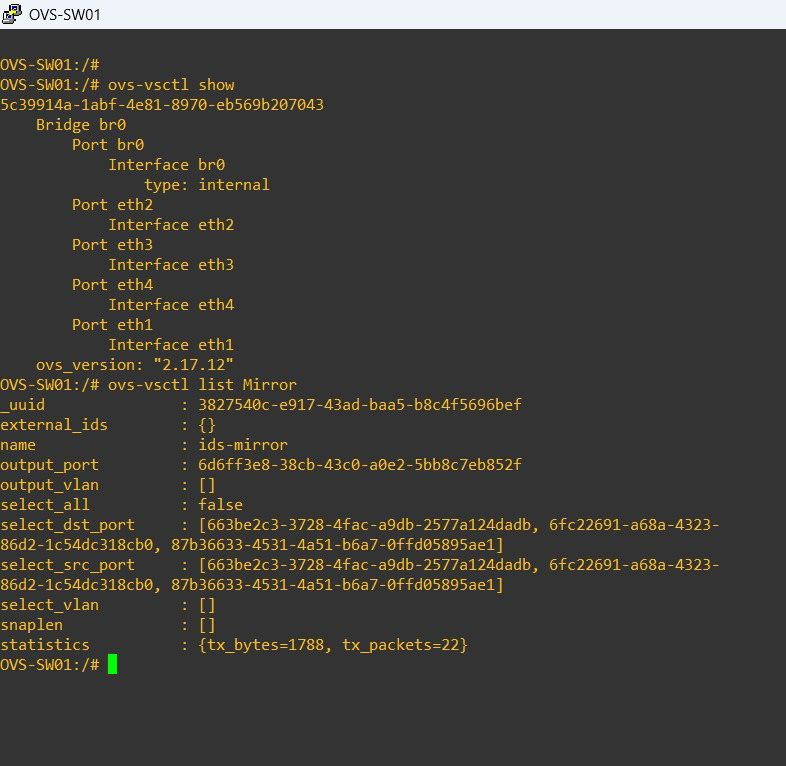

# Open vSwitch Configuration



## Purpose

OVS-SW01 aggregates the protected-lab traffic and sends a mirrored copy to the passive IDS sensor. The IDS therefore observes traffic without sitting inline and without blocking or routing packets.

## Verified OVS Version

```text
Open vSwitch 2.17.12
```

## Final Port Mapping

```text
eth1 -> WEB-SRV01
eth2 -> CLIENT01
eth3 -> IDS Sensor
eth4 -> Attack Switch uplink
```

The OVS bridge is `br0`.

## Bridge Creation

The bridge and ports were created with:

```bash
ovs-vsctl add-br br0
ovs-vsctl add-port br0 eth4
ovs-vsctl add-port br0 eth1
ovs-vsctl add-port br0 eth2
ovs-vsctl add-port br0 eth3
```

If a port is already attached, OVS may report that it already exists; this does not require adding it again.

## Mirror Configuration

The final mirror is named `ids-mirror`. Traffic from the attacker uplink, web server and client is selected in both directions and copied to the IDS output port.

```bash
ovs-vsctl \
-- --id=@attack get Port eth4 \
-- --id=@web get Port eth1 \
-- --id=@client get Port eth2 \
-- --id=@ids get Port eth3 \
-- --id=@m create Mirror name=ids-mirror \
select-src-port=@attack,@web,@client \
select-dst-port=@attack,@web,@client \
output-port=@ids \
-- set Bridge br0 mirrors=@m
```

## Verification

Verify the bridge and attached ports:

```bash
ovs-vsctl show
```

Expected structure:

```text
Bridge br0
  Port br0
    Interface br0
      type: internal
  Port eth1
    Interface eth1
  Port eth2
    Interface eth2
  Port eth3
    Interface eth3
  Port eth4
    Interface eth4
```

Verify the mirror:

```bash
ovs-vsctl list Mirror
```

The verified lab output showed:

```text
name            : ids-mirror
select_all      : false
select_src_port : configured
select_dst_port : configured
output_port     : configured
statistics      : tx_bytes / tx_packets present
```

The mirror statistics increasing confirms that mirrored packets are being transmitted toward the IDS port.

## IDS-Side Verification

On the IDS sensor:

```bash
sudo tcpdump -ni ens3
```

Generate traffic between CLIENT01 / attackers and WEB-SRV01. Packets should appear on `ens3` even though the interface has no IP address.

## Design Notes

- `eth3` is dedicated to the IDS mirror output.
- The IDS is passive; it does not route the test traffic.
- Attackers connect through the Attack Switch and enter OVS through `eth4`.
- WEB-SRV01 and CLIENT01 connect directly to OVS through `eth1` and `eth2`.
