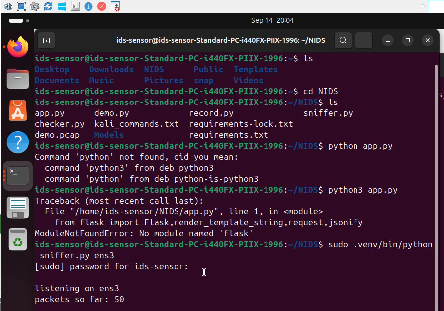
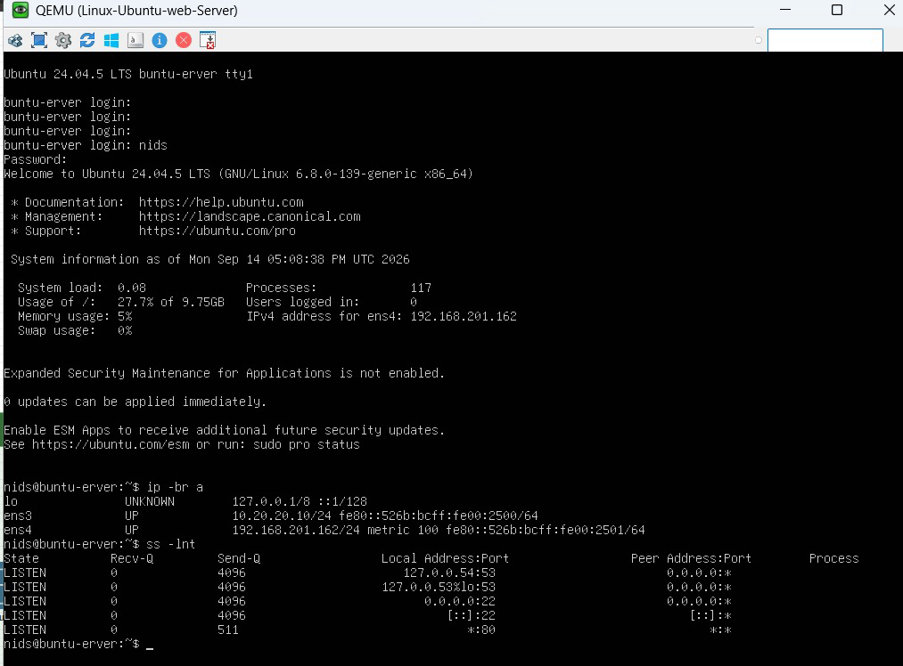
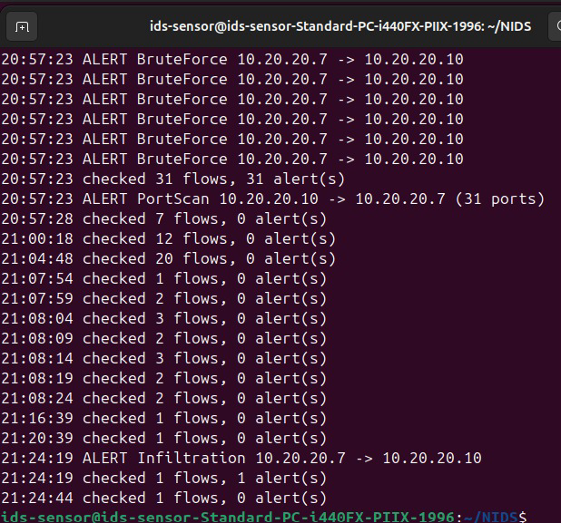
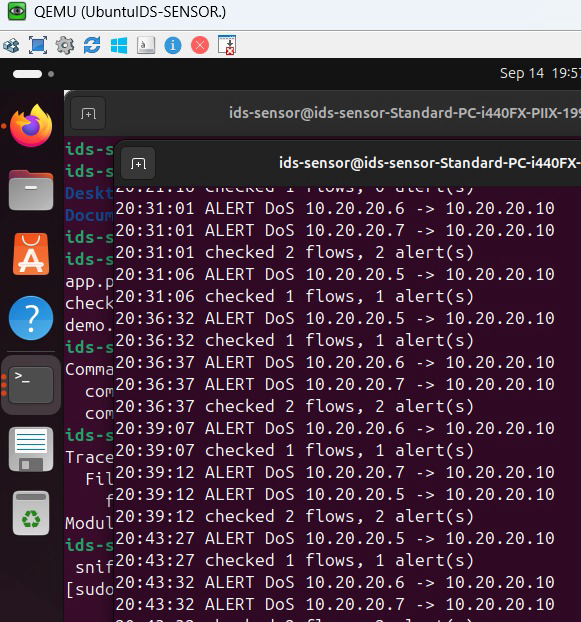
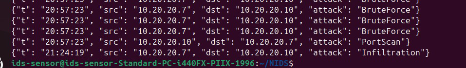
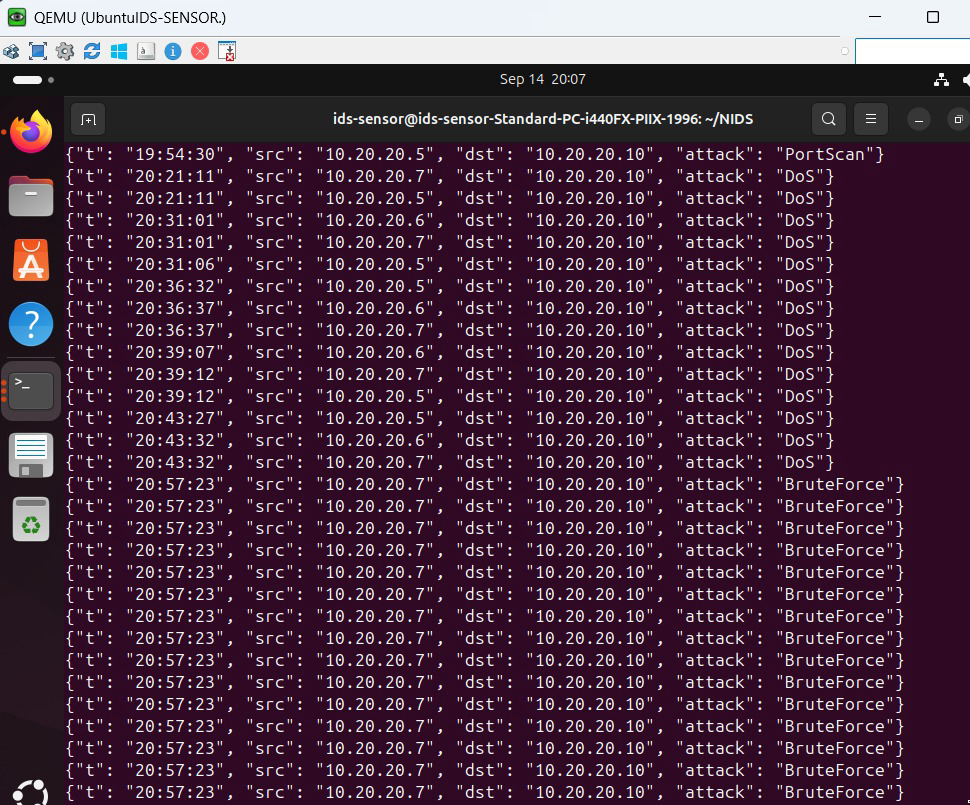
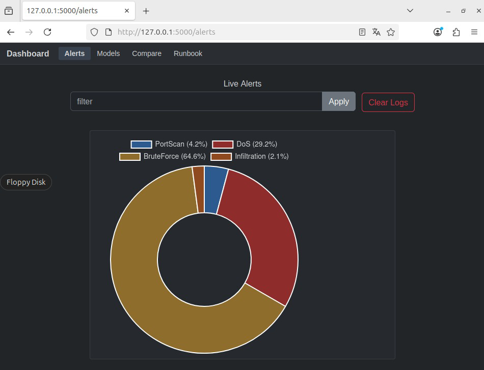

# Live NIDS Testing

## 1. Test Objective

The live tests validate the end-to-end path:

```text
Traffic generation
    -> PNETLab switching
    -> OVS mirror
    -> IDS ens3
    -> Scapy packet capture
    -> flow construction
    -> ML prediction + runtime rules
    -> alert/log output
    -> Flask dashboard
```

A test is marked **PASS** only when the expected live IDS result was actually observed. Traffic generation by itself is not considered a successful detection.

## 2. Current Result Summary

| Class | Result | Observation |
|---|---|---|
| Benign | PASS criterion: no alert | Normal client traffic should not create an alert |
| PortScan | PASS | PortScan alert observed |
| BruteForce | PASS | BruteForce alert observed |
| DoS | PASS | DoS alert observed |
| DDoS | NOT DETECTED | Three-source test did not produce a DDoS alert in the dashboard |
| WebAttack | NOT DETECTED | Repeated HTTP traffic reached IDS but no WebAttack alert appeared |
| Bot | NOT DETECTED | Long repeated TCP traffic reached IDS but no Bot alert appeared |
| Infiltration | PASS | Infiltration alert observed |

## 3. Pre-Test Checks

Start the IDS dashboard:

```bash
cd ~/NIDS
source .venv/bin/activate
python app.py
```

Start the live sniffer in a second terminal:

```bash
cd ~/NIDS
sudo .venv/bin/python sniffer.py ens3
```

Confirm that the packet counter increases when traffic crosses OVS.



On WEB-SRV01, verify the main services:

```bash
ss -lnt
```

Expected permanent listeners include SSH (`22`) and HTTP (`80`).



---

## 4. Benign

### Purpose

Verify that normal traffic is visible to the IDS without generating a false attack alert.

### Source

```text
CLIENT01 -> 10.20.20.20
```

### Target

```text
WEB-SRV01 -> 10.20.20.10
```

### Test Traffic

```bash
ping -c 4 10.20.20.10
curl http://10.20.20.10
```

Optional repeated normal HTTP traffic:

```bash
for i in $(seq 1 5); do curl -s http://10.20.20.10 >/dev/null; sleep 2; done
```

### Expected Behavior

The IDS sees the traffic, but the current dashboard is alert-oriented and does not create an `alerts.json` record for a Benign classification.

### Result

```text
PASS criterion: traffic succeeds and no false alert is generated.
```

---

## 5. PortScan

### Runtime Pattern

The current live rule tracks TCP SYN destination ports and raises PortScan when at least 30 destination ports are observed within a five-second window. A cooldown prevents immediate duplicate alerts.

### Target

```text
10.20.20.10
```

### Result

```text
PASS
```

A PortScan alert was observed in the live IDS.



### Observed Limitation

An apparent reverse-direction PortScan alert was also observed during testing, with WEB-SRV01 shown as the source toward an attacker. This is treated as a possible false positive and should be reviewed in the PortScan SYN-direction logic. A likely area to inspect is whether response traffic such as SYN-ACK packets or changing ephemeral ports is being counted as scan behavior.

---

## 6. BruteForce

### Runtime Pattern

The current rule looks for repeated small SSH flows:

```text
Destination port = 22
Forward packets <= 15 per flow
20+ grouped flows
```

### Target

```text
10.20.20.10:22
```

### Test Method

Repeated SSH authentication attempts / short SSH connections were generated toward WEB-SRV01.

### Result

```text
PASS
```

The IDS displayed BruteForce alerts toward `10.20.20.10`. The same sniffer evidence image is shown in the PortScan section above.

---

## 7. DoS

### Runtime Pattern

The current runtime rule identifies heavy one-way SYN behavior:

```text
Forward packets >= 200
Backward packets = 0
SYN count >= 100
```

### Temporary Server Rule

Before the SYN-flood test, WEB-SRV01 was configured to silently drop SYN packets sent to TCP/8081:

```bash
sudo iptables -I INPUT 1 -p tcp --dport 8081 --syn -j DROP
```

This avoids SYN-ACK replies and creates a clearer one-way flow for the detector.

### Example Traffic

From one attacker:

```bash
sudo hping3 -S --flood -p 8081 10.20.20.10
```

Stop after several seconds with `Ctrl+C`.

### Result

```text
PASS
```

A DoS alert was observed.

The live sniffer recorded DoS alerts from the test sources.



### Cleanup

```bash
sudo iptables -D INPUT -p tcp --dport 8081 --syn -j DROP
```

---

## 8. DDoS

### Runtime Pattern

The current DDoS logic promotes DoS behavior to DDoS when three or more source IP addresses target the same destination with DoS-like flows.

### Sources

```text
10.20.20.5
10.20.20.6
10.20.20.7
```

### Target

```text
10.20.20.10:8081
```

### Test Method

DoS/SYN-flood traffic was generated from all three attackers toward the same target. The server-side SYN DROP rule was used so the flows remained predominantly one-way.

Example command on each attacker:

```bash
sudo hping3 -S --flood -p 8081 10.20.20.10
```

### Result

```text
NOT DETECTED
```

The test traffic was generated, but a DDoS alert did not appear in the dashboard. Therefore this test is not reported as a pass.

The same live evidence shows traffic from `10.20.20.5`, `10.20.20.6`, and `10.20.20.7` being classified as **DoS** rather than being promoted to **DDoS**. This is the evidence for the current DDoS test result.


### Suspected Runtime Cause

The current detector classifies completed flows in periodic flush batches. A plausible cause is that DoS candidates from the three source IPs may be finalized in different batches, so all three sources are not simultaneously available to the DDoS grouping logic.

This is a hypothesis based on the current runtime design and requires code-level verification before being reported as the confirmed cause.

### Proposed Code Improvement

Keep recent DoS sources per destination for a short time window rather than using only the current batch. Conceptually:

```python
ddos_sources = {}
DDOS_WINDOW = 10
```

Then retain source timestamps for each destination and promote to DDoS when three distinct recent DoS sources are present. This change should be validated before it is merged into the final detector.

---

## 9. WebAttack

### Runtime Pattern

The current WebAttack live rule is behavioral rather than payload-signature based:

```text
Destination port = 80
Forward packets <= 8 per flow
10+ grouped HTTP flows
```

It does not directly parse SQL injection or XSS payload semantics in the live rule.

### Test Method

Multiple separate HTTP requests were generated toward WEB-SRV01. Examples used during testing included repeated `curl` requests and explicit `Connection: close` attempts.

Example:

```bash
for i in $(seq 1 20); do curl -s -o /dev/null -H 'Connection: close' http://10.20.20.10/; sleep 0.2; done
```

### Observation

The IDS packet counter increased, confirming that the mirrored HTTP traffic reached the sensor.

### Result

```text
NOT DETECTED
```

No WebAttack alert appeared.

> **Evidence placeholder:** a clean WebAttack generation/post-test capture was not retained in the final screenshot set. The test result remains documented from the live session.

### Suspected Cause

Possible causes include:

- the HTTP flows being split across separate detector flush batches;
- the grouped-flow counter not persisting long enough;
- individual flows exceeding the `Fwd <= 8` condition.

These are investigation points rather than confirmed causes.

---

## 10. Bot

### Runtime Pattern

The current Bot rule expects:

```text
Flow duration > 10 seconds
Forward packets between 10 and 80
Forward packet-size standard deviation = 0
```

### Server Listener

On WEB-SRV01:

```bash
nc -lvkp 9001
```

### Client Traffic

From an attacker:

```bash
for i in $(seq 1 20); do printf 'AAAAAAAAAAAAAAAAAAAA\n'; sleep 1; done | nc -q 1 10.20.20.10 9001
```

### Observation

The repeated payload was visibly received on WEB-SRV01 and the IDS packet counter increased, confirming connectivity and mirrored capture.

### Result

```text
NOT DETECTED
```

### Suspected Cause

The exact condition `packet-size std == 0` is very strict for a real TCP flow. TCP control packets such as SYN, ACK and FIN may have different sizes even when the application payload is constant. Therefore the measured standard deviation may not be exactly zero.

This should be verified against the actual `sniffer.py` feature calculation before changing the rule. A future improvement could use a small tolerance or evaluate payload-carrying packets only.

Stop the temporary listener with `Ctrl+C` after the test.

---

### Evidence

> **Evidence placeholder:** the final documentation set does not include a clean Bot-test screenshot. The live test observation is retained in the written result.

---

## 11. Infiltration

### Runtime Pattern

The current rule expects a large forward transfer:

```text
Forward bytes >= 100000
Forward packets > 100
```

### Server Listener

On WEB-SRV01:

```bash
nc -lvkp 9002 > /tmp/received.bin
```

### Transfer

From an attacker:

```bash
dd if=/dev/zero bs=1024 count=2048 | nc 10.20.20.10 9002
```

This transfers approximately 2 MiB, comfortably exceeding the byte threshold.

### Result

```text
PASS
```

An Infiltration alert was observed.

The recorded alert output confirms the Infiltration classification.



Stop the temporary listener with `Ctrl+C` after the transfer.

---

## 12. Consolidated Alert and Dashboard Evidence

The runtime alert file preserves the observed alert classes generated during the live tests.



The Flask dashboard summarizes the current live alert distribution.



---

## 13. Final Live-Test Status

```text
Benign        PASS criterion: no false alert
PortScan      PASS
BruteForce    PASS
DoS           PASS
DDoS          NOT DETECTED
WebAttack     NOT DETECTED
Bot           NOT DETECTED
Infiltration  PASS
```

The live testbed successfully validates the complete capture and alerting path, while also exposing three runtime cases that still require detector refinement. These failed live detections are documented as current limitations rather than hidden or reclassified as successful tests.
